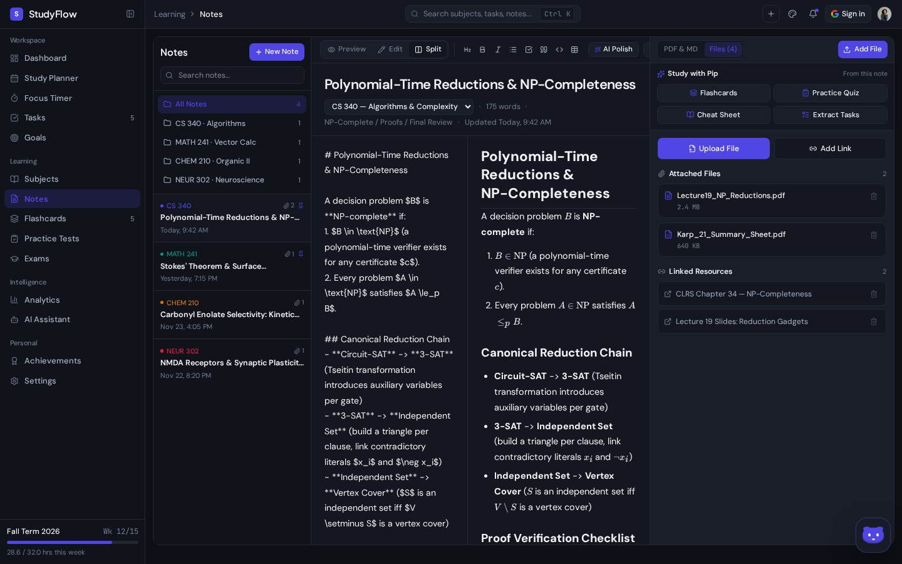

# StudyFlow

StudyFlow brings your study calendar, focus timer, notes, and exam preparation into one workspace. The Windows desktop app uses Tauri and Rust with a React interface and local SQLite storage.


The screenshots show the current interface with example study data and an example Pip conversation.

## Plan your week

Schedule and edit study blocks in day, week, month, or agenda view. Keep personal blocks visible on the calendar by switching off **Counts toward study time**. The dashboard surfaces current and upcoming sessions, and subject cards compare completed hours with scheduled study time. Use the task board and goals to track work, and add exams with or without a subject.


## Focus on the current session

Start from the active calendar block with **Quick-Start Focus**, or choose Pomodoro, countdown, stopwatch, or a custom timer. Keep time visible with a floating mini-timer. Study sessions and reviews earn progress toward achievements. Choose a break duration when taking a break.


## Work with notes and PDFs

Search notes, assign them to subjects, and attach PDFs. Draw, highlight, and type annotations directly on pages. **Prepare Markdown** extracts selectable text locally and can place aligned tables and embedded figures inline. The original page image stays available for reference, including for scanned pages. In the desktop app, choose **Recognize scanned text** after preparing Markdown to read image-only pages offline. Recognized text is saved with the note for flashcards and practice questions. Windows uses its installed OCR language packs. Linux uses a local Tesseract installation.



## Practice and review

Generate flashcards from a selected note section, review the draft, and add the cards to a spaced-repetition deck. Generate timed practice tests with multiple-choice, multiple-select, or short-answer questions. Open a saved attempt to see the original answers, marks, and feedback.


## Study with Pip

Open **AI Assistant** or the floating Pip button. Pip can use selected workspace context, read screenshots, draft syllabus outlines from PDF or Word files, and propose calendar or task edits for you to review. Open **Chat history** to resume a previous conversation.

Choose one of the four configured Gemini chat models and enter your own API key under **Settings → AI Usage**. Desktop keys use the native credential store when available; browser keys stay in memory for the current tab. Gemini receives the messages, enabled workspace context, and attachments you send. Expand **View usage** for provider-reported token counts.


## Run locally

Install Bun and Node.js 22.12 or newer.

```sh
bun install --frozen-lockfile
bun run dev
```

Open [localhost:3000](http://localhost:3000). The local dev server also provides the browser preview's Pip backend. It binds to loopback by default. Server-owned keys are restricted to direct loopback requests; remote clients must provide their own API key.

For desktop development on Windows, install the stable Rust MSVC toolchain, Microsoft C++ Build Tools, and Edge WebView2, then run `bun run tauri dev`. The Windows installer workflow runs on manual dispatch.

## Desktop workspace and sign-in

On first launch, create a local study profile or use Google sign-in. Google sign-in opens your default browser and requires the publisher to configure the desktop OAuth client through `STUDYFLOW_GOOGLE_CLIENT_ID` and `STUDYFLOW_GOOGLE_CLIENT_SECRET`. Study records and desktop chat history stay in the local SQLite database.

In **Settings → Data & Backup**, use **Import** to migrate a schema 17 SQLite backup, **Export Workspace JSON** to save a copy of your workspace, or **Reset workspace data** to choose which sections to clear.

## Study Lab and safety

Use Study Lab for symbolic and numerical math, JavaScript and Python workers, SQLite, C++ dry-run explanations, and the SVG Whiteboard. Python downloads a pinned WebAssembly runtime on first use. Workers limit execution time but are not a privilege sandbox; only execute code you trust. Pip requires review for bulk additions and explicit opt-in for sensitive changes, including note replacement.

## Checks

```sh
bun run lint
bun run build
node --import tsx --test src/utils/*.test.ts src/assistant/*.test.ts src/companion/*.test.ts src/firebase/*.test.ts src/mobile/*.test.ts src/lab/*.test.ts server/*.test.ts server/companion/*.test.mjs
```

Run `bun run preview` to open the production web build locally.
