<div align="center">

# StudyFlow

**A calm, unified study workspace for planning weeks, running deep-focus blocks, annotating lecture notes, tracking retention, and studying with Pip.**

Built for web and Windows desktop (**React 19 · TypeScript · Vite · Tauri / Rust · SQLite · Gemini · Firebase Auth**), paired with a live **Android Companion** workbench.

[Explore Demo Mode](#built-in-demo-workspace) · [Feature Showcase](#feature-showcase) · [Android Companion](#android-companion) · [Run Locally](#run-locally) · [Verification Checks](#verification-checks)

<br />


</div>

---

## Built-in Demo Workspace

StudyFlow ships with pre-populated sample academic courses (`CS 340`, `MATH 241`, `CHEM 210`, `NEUR 302`, `ECON 205`), scheduled sessions, focus logs, milestones, KaTeX lecture notes, spaced-repetition flashcards, practice tests, and exams so every view works out of the box:

- **Web Sign-In Screen:** Click **Explore Demo** next to **Continue with Google** (or visit `/?demo=1`) to browse the full workspace immediately without creating an account.
- **Restore Any Time:** Open **Settings → Data & Backup** and click **Load Demo Data** to repopulate the sample semester workspace cleanly.

---

## Feature Showcase

### 1. Focused Sign-In & Command Center Dashboard

Start from a clean sign-in page with an interactive 4-chapter live product preview (**Planner**, **Focus**, **Notes**, **Pip AI**), light/dark theme toggle, Google authentication, and one-click **Explore Demo** access.

Inside the workspace, the **Dashboard** brings together a customizable widget layout (**Customize Dashboard**), live **Today's Study Schedule**, **Quick-Start Focus** timer, **Subject Progress** pacing bars, **Upcoming Sessions**, **Recent Notes & Tasks Due**, and **Pip AI Study Overview**—surfacing overdue tasks, due flashcards, open focus windows, and actionable next moves.

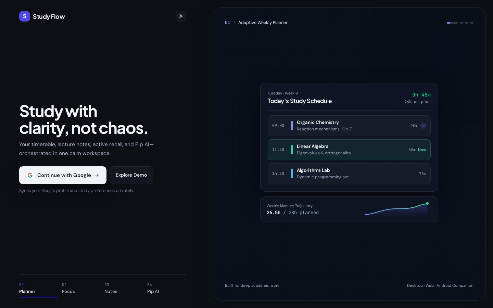

---

### 2. Study Planner & Calendar Architecture

Plan across **Day**, **Week**, **Month**, and **Agenda** views with color-coded subject sessions, current-time indicator, recurring series editing, and task drag-and-drop scheduling from **Unscheduled Tasks**.

- Toggle **Counts toward study time** on any block so personal breaks, sleep, and meals remain visible on your schedule without inflating academic target hours.
- Monitor weekly pacing per course in **Weekly Study Load** and filter between **All Subjects**, specific courses, or **Study blocks only**.

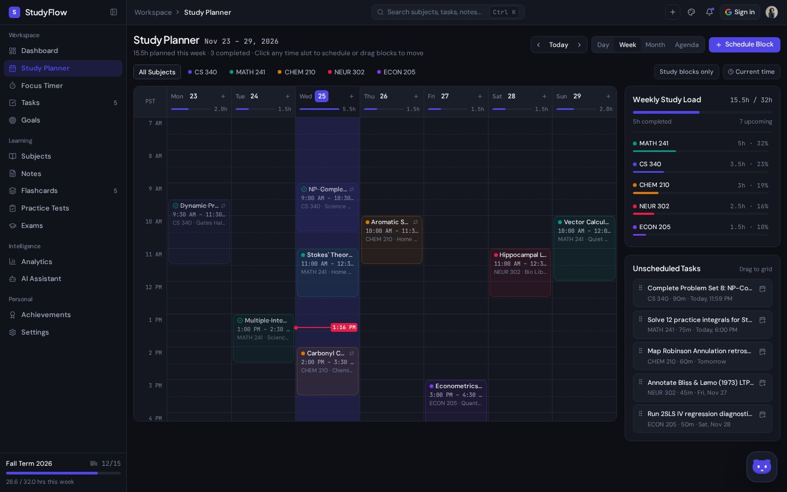

---

### 3. Distraction-Free Focus Timer

Stay locked in with **Pomodoro** cycles or **Custom** focus timers (`25m`, `45m`, `1h`, `2h` presets or custom **Hr : Min** intervals up to **10 hours**), plus automatic **Scheduled** block detection that sets the timer to the remainder of your active calendar block.

- **Mid-Session Breaks:** Pause an active study interval anytime with **Take Break** and pick a break duration (`5m`–`30m` or custom minutes) from a focused popup without ending your tracked session.
- **Automatic Session Alerts & Mini-Timer:** Receive automatic interruption banners when a planned calendar session starts, detach a floating mini-timer or expand to full-screen mode, and rate completed blocks (`1–5` stars) in **Recent Sessions**.

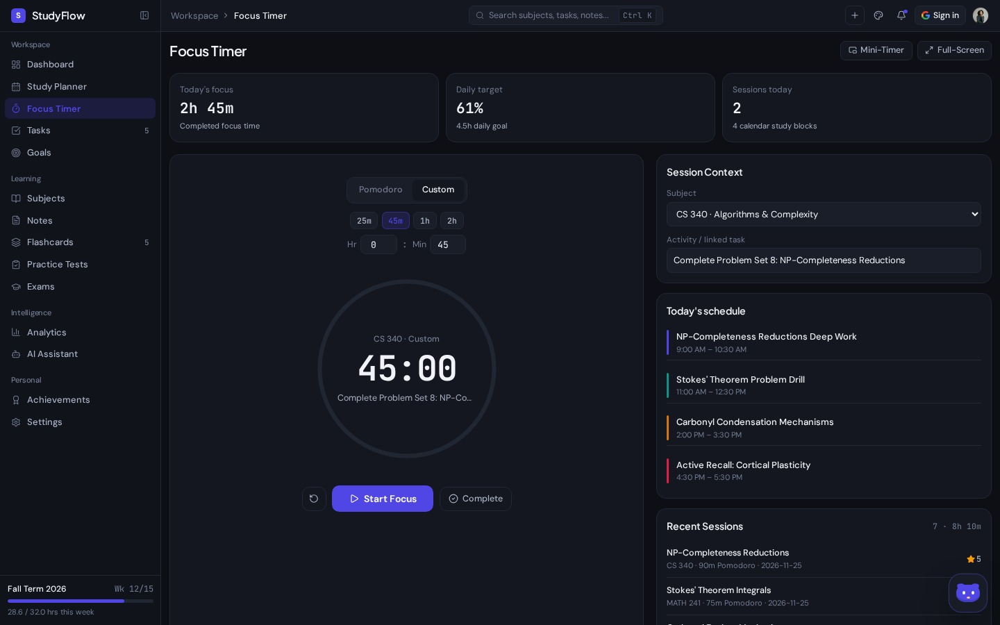

---

### 4. Goals, Milestones & Task Board

Track **Daily**, **Weekly**, **Subject**, **Syllabus**, **Revision**, and **Tasks** targets from one progress hub.

- **Task-Linked Milestones:** Add standalone milestones, link existing tasks, or create new tasks right from the **Add Milestone** modal—completing a linked task automatically checks off its milestone and advances goal progress.
- **Flexible Sorting & History:** Sort milestones by **Due date ↑/↓**, **Title A–Z**, **Incomplete first**, **Completed first**, or switch to **Manual order** to reorder steps directly, alongside a **Weekly Target vs Actual** breakdown and **Goal Achievement History**.
- Pair goals with the **Tasks** workspace across **List**, **Kanban Board**, and **Calendar** views with subtasks, priority filters, and bulk selection.

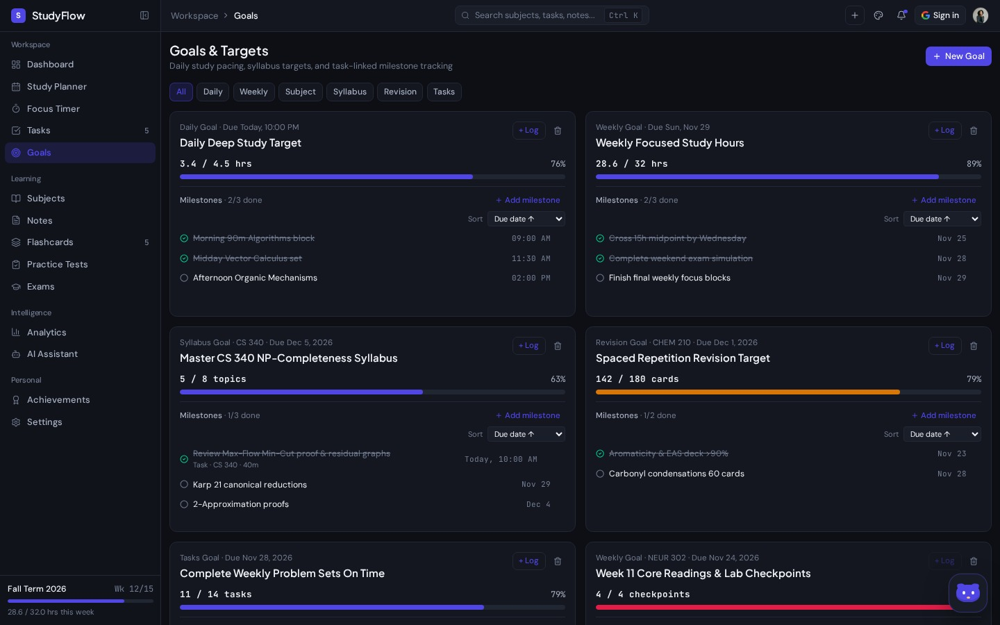

---

### 5. Courses, Chapters & Syllabus Deep Import

Organize active and archived courses in **Subjects & Courses** (`Grid` or `List` views) with weekly scheduled vs completed hours, instructors, current grades, exam countdowns, and per-chapter topic difficulty/confidence tracking.

- Use **Import Syllabus** inside **Subjects** or **Exams** to upload a course syllabus **PDF** or **DOCX**—Pip extracts exam dates, weightings, tasks, and syllabus chapters into a review checklist before adding anything to your calendar.

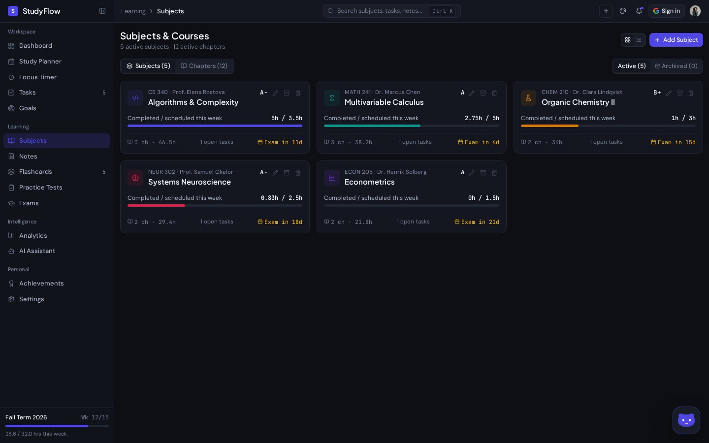

---

### 6. Notes, KaTeX Math & PDF Workspace

Write and preview structured Markdown with **KaTeX** mathematical notation, **GFM** tables, and dynamic Unicode font rendering in **Preview**, **Edit**, or **Split** modes, grouped by course notebooks and search filters.

- **Attach & Convert Files:** Drop or attach **PDF**, **DOCX**, **DOC**, **MD**, **TXT**, or **CSV** resources; run **Prepare Markdown** to extract local text, aligned tables, and embedded figures while keeping original PDF pages annotated with ink, highlights, and text marks.
- **Offline Desktop OCR & AI Actions:** On desktop, run **Recognize scanned text** (Windows OCR / Linux Tesseract) on image-only PDFs, or trigger **AI Polish**, **Cheat Sheet**, **Flashcards**, **Practice Quiz**, and **Extract Tasks** directly from the active note with 1-click undo for AI edits.


---

### 7. Spaced Repetition & Retention Intelligence

Drill active-recall **Flashcards** with SM-2 spaced repetition (`Again / Hard / Good / Easy`) in **Decks & Review**, import or export **Anki `.tsv`/`.csv`** decks, and monitor exam readiness in **Retention Intelligence**:

- **Forgetting Curve Forecasting:** Inspect **Predicted Recall Today**, **Exam-Day Recall Forecast**, and a **14-Day Forgetting Curve** grounded in each card's interval, ease factor, and review recency.
- **Exam-Risk Mitigation:** Spot **At-Risk Concepts** and **Deck Readiness & Exam-Day Forecast** rows immediately, then click **Schedule Micro-Reviews** to stage targeted calendar review blocks.

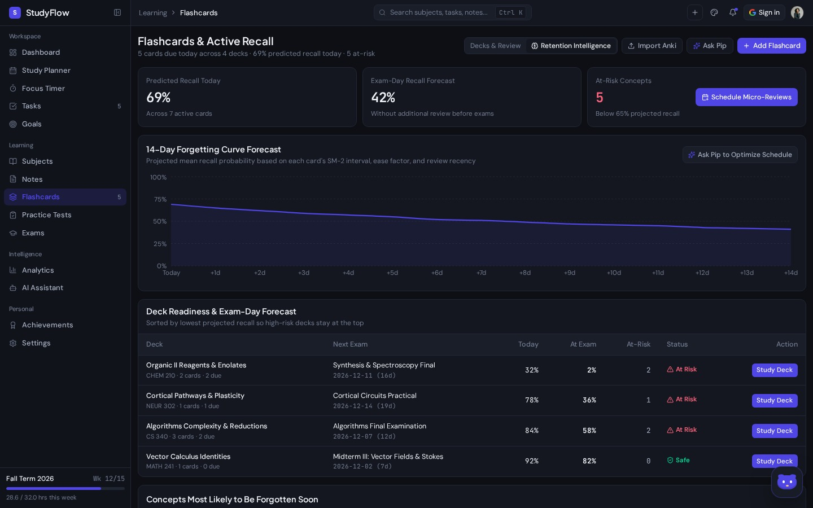

---

### 8. Practice Tests & Exam Roadmap

Generate or run timed **Practice Tests** supporting multiple-choice, multiple-select, and short-answer prompts with optional AI rubric grading. Completed attempts preserve original answers, per-topic accuracy breakdowns, and weak-topic follow-ups.

Track every upcoming midterm and final on the **Exams** roadmap with live countdowns, syllabus completion links, grade weights, and preparation checklists.


---

### 9. Analytics & Insights

Inspect daily, weekly, and monthly study telemetry across **Total Study Hours**, **Schedule Adherence**, **Average Focus Quality**, **Planned vs Actual Study Time**, **Study Time by Subject**, **Productivity Trends**, **Focus Duration Distribution**, a 14-week **Study Consistency Heatmap**, and **Peak Productivity Hours**.

Customize the look and ergonomics of your workspace across **6 themes** (`Light`, `Dark`, `Midnight`, `Ocean Blue`, `Forest Green`, `Warm Neutral`), **8 accent presets + custom color picker**, **Compact / Comfortable** density, `Ctrl+K` Command Palette, and **Achievements (Beta)** XP tracking.

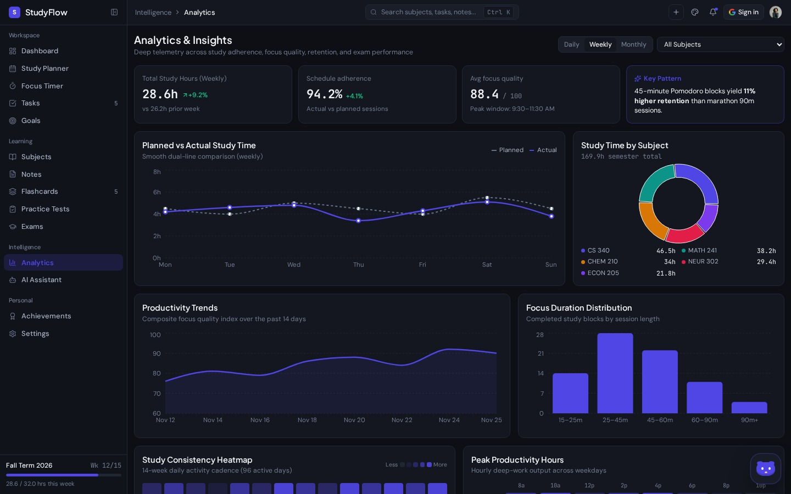

---

### 10. Pip AI Study Coach & Approval Safety Gates

Open **AI Assistant** (or the floating Pip drawer from any page) for multi-thread study planning, concept explanations with **KaTeX** and **SVG diagram generation**, note-to-deck creation, and syllabus breakdown:

- **Workspace-Aware & Multimodal:** Toggle **Workspace** context visibility and attach PDFs, DOCX/PPTX slides, Markdown/CSV files, code snippets, or screenshots. Switch between configured Gemini models (`gemini-3.5-flash-lite`, `gemini-4-hydrogen`, `gemini-3.1-pro-preview`, `gemini-3.8-flash`) directly in the composer.
- **Explicit Approval Before Changes:** Bulk workspace additions (multiple tasks, sessions, decks, quizzes, or syllabi) and sensitive or destructive actions (such as deleting calendar blocks or replacing notes) always render an interactive **Review & approve additions** / confirmation checklist so nothing modifies your workspace without your sign-off.
- **Save & Track Usage:** Save any Pip response straight to **Notes**, edit and resend prompts, or inspect token metrics under **Settings → AI & Usage**.

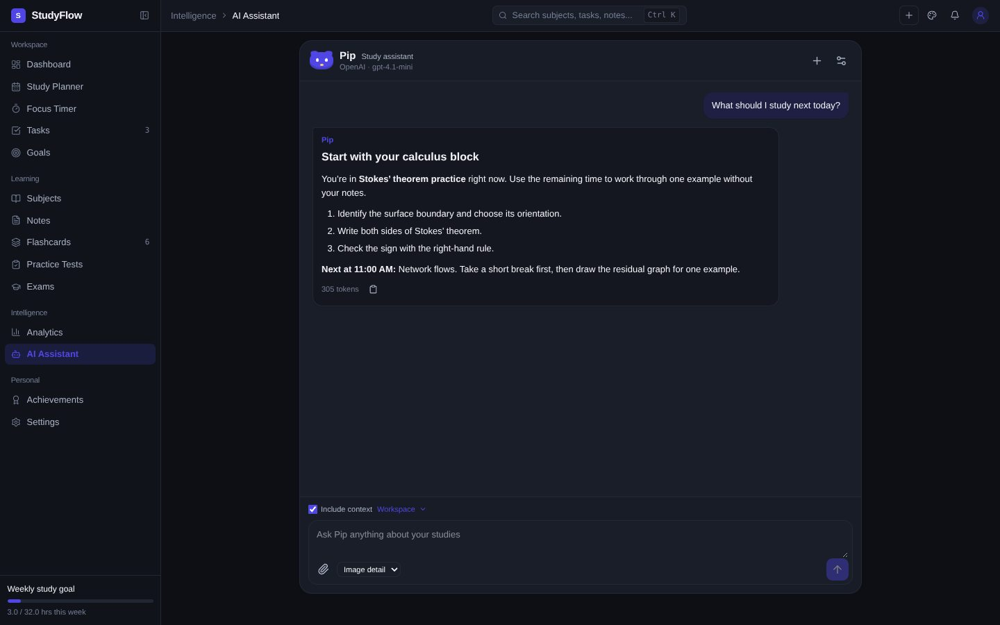

---

## Android Companion

StudyFlow pairs with a companion Android workspace (available on desktop via **Settings → Mobile companion** and previewable interactively in the browser reviewer workbench at `/mobile`):

- **Live Sync:** Pair over local Wi-Fi, Bluetooth, or QR code to keep your today agenda, calendar blocks, focus timer, and 6 desktop themes + accent colors synchronized.
- **Scheduled Alarms & Phone Focus Screen-Time:** Trigger heads-up study reminders, exact study alarms, bedtime wind-down, wake-up dismiss/snooze overlays, and phone screen-time tracking measured strictly during active focus intervals.

<table>
  <tr>
    <td width="50%">
      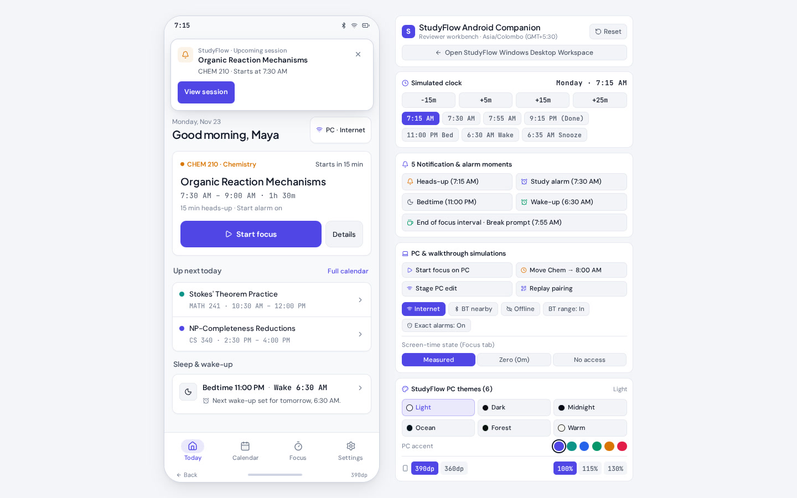
    </td>
    <td width="50%">
      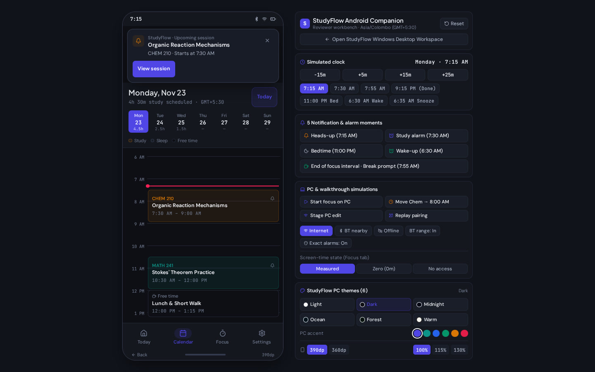
    </td>
  </tr>
  <tr>
    <td width="50%">
      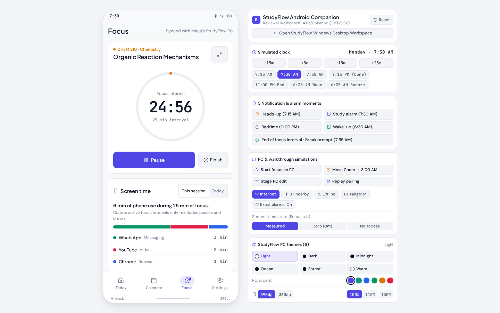
    </td>
    <td width="50%">
      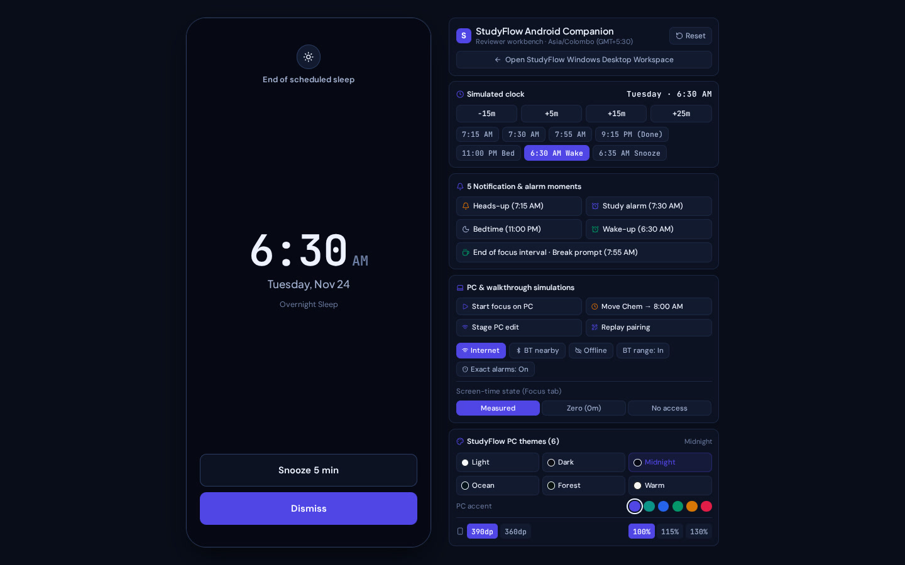
    </td>
  </tr>
</table>

---

## Run Locally

### Prerequisites
- **Node.js 22.12+** (or **Bun**)
- *(Optional for Windows Desktop)* Stable Rust MSVC toolchain, Microsoft C++ Build Tools, and Edge WebView2

### Web Development Preview

```sh
npm install
npm run dev
```

*(You can also use `bun install --frozen-lockfile && bun run dev`.)*

Open **[http://localhost:3000](http://localhost:3000)** and click **Explore Demo** to launch straight into the sample academic workspace, or sign in with Google.

- **AI Backend & Keys:** The local dev server provides the `/api/study-assistant/*` backend (bound to loopback by default; server-owned keys only accept direct loopback requests). You can also enter your own Gemini API key in **Settings → AI & Usage** (desktop keys use the native OS credential store when available; browser keys stay in memory for the active tab).
- **Production Preview:** Run `npm run build && npm run preview` (or `npm start` for full-stack production mode).

### Windows Desktop (Tauri + SQLite)

```sh
npm run tauri dev
```

On first launch, create a local study profile or use Google sign-in (desktop OAuth requires `STUDYFLOW_GOOGLE_CLIENT_ID` and `STUDYFLOW_GOOGLE_CLIENT_SECRET`). All workspace records and chat history persist in local **SQLite**, with schema-17 backup migration, JSON export, selective workspace reset, and **Load Demo Data** available under **Settings → Data & Backup**. *(The Windows installer workflow runs only on manual dispatch.)*

---

## Verification Checks

```sh
npm run lint
npm run build
node --import tsx --test src/utils/*.test.ts src/assistant/*.test.ts src/companion/*.test.ts src/firebase/*.test.ts src/mobile/*.test.ts src/lab/*.test.ts server/*.test.ts server/companion/*.test.mjs
```
