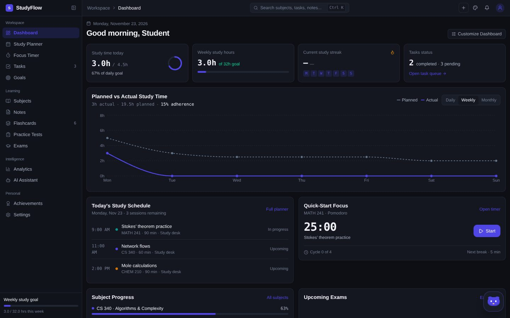
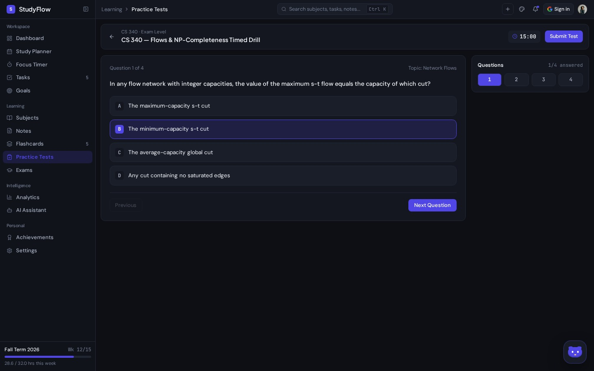

  <h1>StudyFlow</h1>
  
<strong>Your entire study life. One workspace.</strong>

  
Plan your days, stay focused, organize your learning and prepare for exams.

  

    
    
    
  

  

## Everything starts with your dashboard

See what's coming up, how much you've studied and how closely you're following your plan. Start your next session without searching through menus.

## Make time for what matters

Create a study routine around your life, not the other way around.

- Color-coded calendar with daily, weekly and monthly views.
- Recurring lessons, revision sessions, breaks and sleep blocks.
- Subject-based tasks, goals and sortable milestones.
- Syllabus progress and upcoming exams.

## Find your focus

Give every study session your full attention.

- Pomodoro, countdown, stopwatch and custom timers.
- Quick-start focus directly from your schedule.
- Floating mini-timer and customizable focus environment.
- Study history, achievements and progress insights.

## Learn. Review. Remember.

<table>
  <tr>
    <td width="50%" valign="top">
      
      <h3>Notes &amp; resources</h3>
      Keep your learning materials organized. Annotate PDFs, extract text from scanned pages and turn documents into editable notes.
    </td>
    <td width="50%" valign="top">
      
      <h3>Practice &amp; revision</h3>
      Create flashcards, review with spaced repetition, take timed practice tests and learn from your mistakes.
    </td>
  </tr>
</table>

## Meet Pip, your personal study assistant

An AI assistant that understands your study workspace.

Ask Pip to help plan your week, break down a syllabus, organize tasks, create notes or make sense of your study materials. Review proposed workspace changes before applying them.

## Take your studies with you

**StudyFlow for Android** keeps your routine within reach, even when you're away from your PC.

| Stay on schedule | Stay focused |
| :--- | :--- |
| Upcoming-session reminders | Synchronized focus timer |
| Study and wake-up alarms | Offline subject-based timers |
| Upcoming-session home screen widget | Focus widget |
| Offline access to your synced calendar | Deep-focus warnings and screen-time tracking |

## Make it yours

Choose a theme, customize your dashboard, set your own study targets and build a routine that works for you.

Track planned versus actual study time, celebrate achievements and see your progress across every subject.

---

  <h3>Less time organizing. More time learning.</h3>
  
<a href="https://github.com/gaganaweerakoon/StudyFlow/releases">Releases</a> · <a href="https://github.com/gaganaweerakoon/StudyFlow/issues">Feedback &amp; suggestions</a>

  StudyFlow is currently in alpha. Screenshots show example study records.

